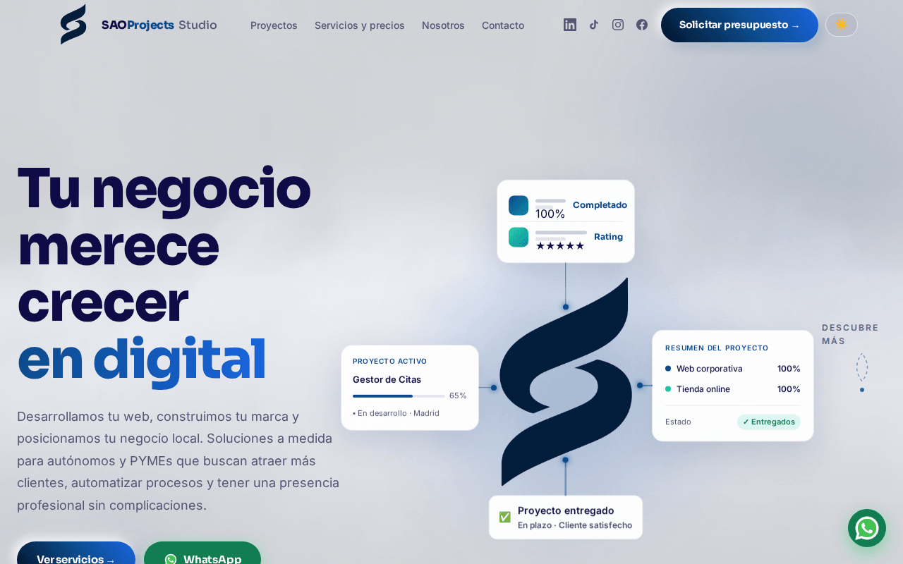
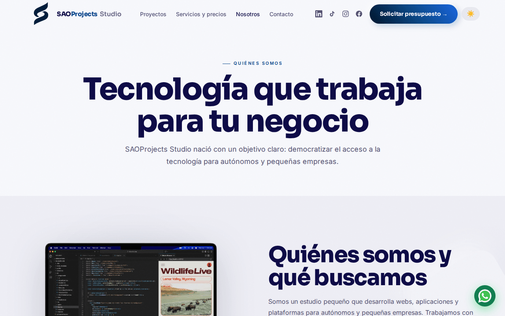
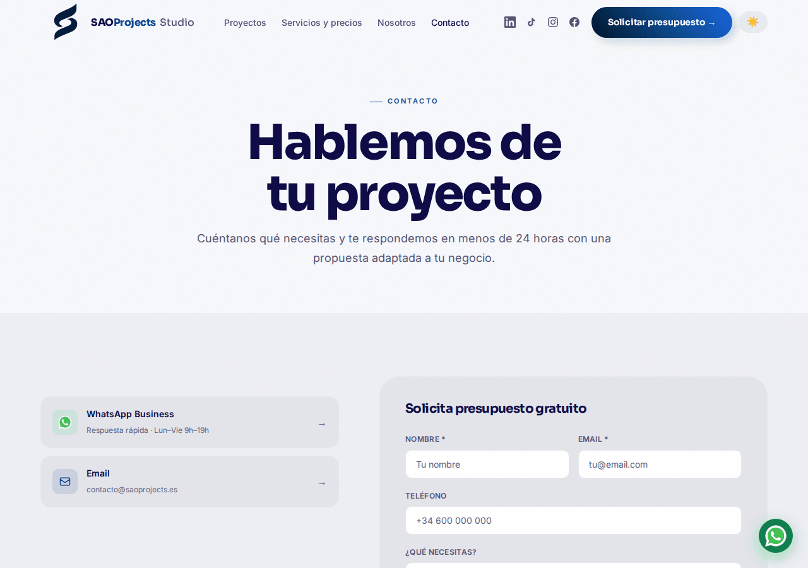
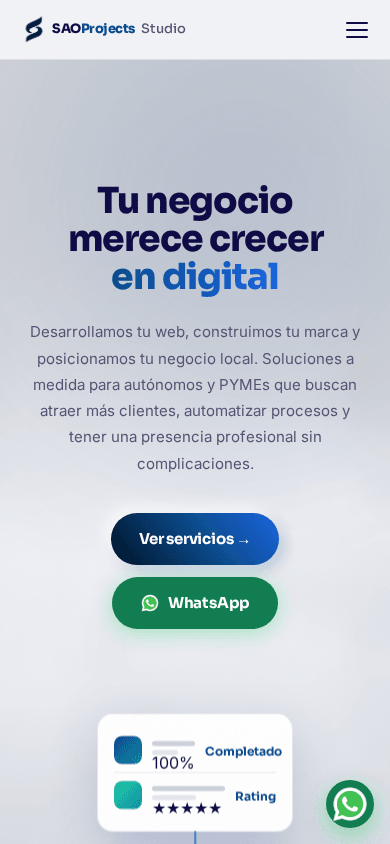
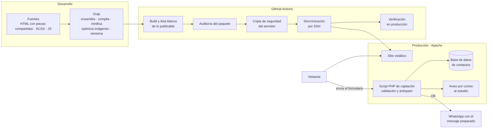

# saoprojects.es · Caso de estudio

**Web del estudio SAOProjects con embudo de captación.** Un sitio rápido, accesible y sin framework en el que cada contacto se guarda en servidor antes de abrir la conversación.

**Web:** <https://saoprojects.es>

## Contexto y problema

Es el escaparate comercial de SAOProjects Studio, y cada cambio se juzga por si ayuda o estorba a captar clientes.

La versión anterior era una sola página estática. Su único canal de conversión era un formulario que no enviaba nada al servidor: componía un mensaje y abría WhatsApp. Si la persona no llegaba a escribir, el contacto se perdía sin dejar rastro.

Había que resolver cuatro cosas:

- Que **ningún contacto se pierda**.
- Saber **de dónde viene** cada uno (página y campaña).
- Guardar **prueba del consentimiento RGPD**.
- Todo ello **sin perder rendimiento** ni la sencillez de un sitio estático.

## Mi papel

Diseño, desarrollo, despliegue y soporte: identidad y maquetación, arquitectura del sitio, backend de captación, pipeline de despliegue continuo y medición de rendimiento y accesibilidad.

## Funcionalidades clave

**Páginas:** portada, servicios, nosotros, contacto, una landing de producto con formulario corto, una página 404 propia y las páginas legales.

**Embudo de captación:**

1. El visitante llega a la portada, a una página interior o a la landing, a veces desde un enlace de campaña.
2. Las tarjetas de servicio llevan al formulario de contacto con el servicio ya elegido.
3. El formulario registra, sin que se vea, la página de origen y la campaña.
4. Al enviarlo, el servidor valida el contacto, lo guarda en la base de datos y avisa al estudio por correo.
5. Solo cuando el servidor confirma que lo ha guardado, el navegador abre WhatsApp con el mensaje preparado.

**Validación en servidor:**

- Límites de longitud coherentes en el formulario, el servidor y la base de datos.
- Correo y URL normalizados.
- Teléfono validado por número de dígitos y no por formato, para aceptar lo que la gente escribe de verdad.
- Servicio comprobado contra una lista cerrada y consentimiento obligatorio.
- Antispam sin captcha, con varias capas en servidor.
- Los parámetros de campaña se recortan, nunca se rechazan: un enlace mal formado no puede costar un contacto.

**Rendimiento:**

- Imágenes en AVIF y WebP.
- CSS y JS minificados, con versión por hash de contenido y caché larga.
- Compresión en el servidor.
- El vídeo de la portada pasó de 5,3 MB a unos 330 KB.
- Medición en escritorio: unos 630 KB en 21 peticiones y primer pintado en torno a medio segundo.

**SEO:** dominio canónico, URL limpias con redirecciones 301 desde las antiguas, sitemap, robots, Open Graph y datos estructurados JSON-LD.

**Accesibilidad:** cero fallos de contraste WCAG AA en modo claro y oscuro, respeto a `prefers-reduced-motion`, foco visible y atributos ARIA en la navegación. Auditado con Lighthouse, axe y html-validate.

**Legal:**

- Cada contacto guarda la versión de la política aceptada y la hora del consentimiento. La versión la fija el servidor, no el navegador.
- Sin cookies de análisis ni de publicidad, así que no hace falta banner de cookies.

| Nosotros | Contacto | Móvil |
|---|---|---|
|  |  |  |

## Arquitectura

Las credenciales y los logs viven fuera de la carpeta pública y fuera del repositorio.

## Stack

- **Frontend:** HTML, Sass y JavaScript vanilla sin dependencias.
- **Build:** Gulp con PostCSS, Autoprefixer, cssnano, Terser y optimización de imágenes (WebP y AVIF).
- **Backend:** PHP con PDO y MySQL/MariaDB.
- **Infraestructura:** Apache con `.htaccess` en hosting compartido, GitHub Actions y rsync por SSH.

## Decisiones técnicas y retos resueltos

1. **Guardar primero y avisar después.** El contacto se guarda antes de enviar el correo, y la respuesta es OK aunque el correo falle; el fallo queda registrado. Un problema de entrega nunca pierde un contacto.
2. **WhatsApp sin bloqueo de ventanas emergentes.** La pestaña se abre dentro del propio clic y solo se dirige a WhatsApp cuando el servidor confirma, para que ni Safari ni los bloqueadores la corten.
3. **Antispam sin captcha,** para no añadir fricción al embudo.
4. **Consentimiento verificable:** la versión de la política la pone el servidor y se guarda con la hora de cada contacto.
5. **Dos relojes desfasados:** PHP y la base de datos usaban husos horarios distintos. Ahora todas las fechas salen del reloj de la base de datos y solo se convierten al mostrarlas.
6. **Piezas compartidas sin framework:** Gulp ensambla la cabecera, el pie y los bloques comunes. El despliegue se detiene si las páginas generadas no coinciden con las versionadas, lo que delata una edición a mano o un build olvidado.
7. **Despliegue seguro por lista blanca:** solo se publica lo declarado, con auditoría del paquete, copia de seguridad previa, exclusiones para no borrar lo que solo vive en el servidor y verificación posterior. Hay un modo simulacro.
8. **Tema claro por defecto, a propósito:** es la presentación de marca. Los colores van en variables CSS, así que cambiar la paleta toca un solo fichero.
9. **Bucle de redirecciones evitado:** el HTTPS lo fuerza la plataforma. Forzarlo también en `.htaccess`, detrás de su proxy SSL, provocaba un bucle infinito.

## Estado y roadmap

En producción con despliegue automático desde septiembre de 2026.

**Roadmap:**

- **Backend / CRM del estudio:** gestión de contactos y seguimiento comercial construidos sobre el núcleo de [Inmogestion](https://github.com/ricardo-mendez-saoprojects/inmogestion-case-study) (MVC propio, roles y permisos, migraciones versionadas), en lugar de empezar de cero. Está en camino.
- Aviso de contactos por SMTP autenticado.
- Integrar las páginas legales en el sistema de piezas compartidas.

---

> **Código privado** (proyecto de cliente / en producción). Disponible para revisión en entrevista bajo petición.

<strong>English</strong>

# saoprojects.es · Case study

**The SAOProjects studio website, with a lead capture funnel.** A fast, accessible, framework-free site where every contact is stored on the server before the conversation starts.

**Website:** <https://saoprojects.es>

## Context and problem

It is SAOProjects Studio's commercial storefront, and every change is judged by whether it helps or hurts client acquisition.

The previous version was a single static page. Its only conversion channel was a form that sent nothing to the server: it composed a message and opened WhatsApp. If the person never sent it, the lead was lost without a trace.

Four things had to be solved:

- **No lead must ever be lost.**
- Know **where each lead comes from** (page and campaign).
- Keep **proof of GDPR consent**.
- All of it **without losing performance** or the simplicity of a static site.

## My role

Design, development, deployment and support: branding and layout, site architecture, the lead capture backend, the continuous deployment pipeline, and performance and accessibility measurement.

## Key features

**Pages:** home, services, about, contact, a product landing page with a short form, a custom 404 page and the legal pages.

**Lead capture funnel:**

1. The visitor lands on the home page, an inner page or the landing page, sometimes from a campaign link.
2. Service cards lead to the contact form with that service preselected.
3. The form silently records the source page and campaign.
4. On submit, the server validates the lead, stores it in the database and notifies the studio by email.
5. Only once the server confirms the lead is stored does the browser open WhatsApp with a prepared message.

**Server-side validation:**

- Length limits kept consistent across the form, the server and the database.
- Normalised email and URL.
- Phone numbers validated by digit count rather than format, to accept what people actually type.
- The service is checked against a closed list, and consent is mandatory.
- Captcha-free, multi-layer spam protection on the server.
- Campaign parameters are trimmed, never rejected: a malformed link must not cost a lead.

**Performance:**

- AVIF and WebP images.
- Minified CSS and JS with content-hash versioning and long-term caching.
- Server-side compression.
- The hero video went from 5.3 MB to about 330 KB.
- Desktop measurement: about 630 KB in 21 requests, with first paint at around half a second.

**SEO:** canonical domain, clean URLs with 301 redirects from the old ones, sitemap, robots, Open Graph and JSON-LD structured data.

**Accessibility:** zero WCAG AA contrast failures in light and dark mode, `prefers-reduced-motion` respected, visible focus and ARIA attributes in navigation. Audited with Lighthouse, axe and html-validate.

**Legal:**

- Each lead stores the accepted policy version and the time of consent. The version is set by the server, not the browser.
- No analytics or advertising cookies, so no cookie banner is needed.

## Architecture

See the Mermaid diagram above: sources (HTML with shared partials, SCSS, JS) → Gulp → GitHub Actions (build with an allowlist, package audit, server backup, sync over SSH, production checks) → Apache serving the static site plus a single PHP lead capture script → database and an email notification → WhatsApp opens only after the server confirms. Credentials and logs live outside the public folder and outside the repository.

## Stack

HTML, Sass and dependency-free vanilla JavaScript · Gulp (PostCSS, Autoprefixer, cssnano, Terser, WebP/AVIF image optimisation) · PHP with PDO and MySQL/MariaDB · Apache with `.htaccess` on shared hosting · GitHub Actions and rsync over SSH.

## Technical decisions and challenges

1. **Store first, notify later.** The lead is stored before the email is sent, and the response is OK even if the email fails; the failure is logged. A delivery problem never loses a lead.
2. **WhatsApp without popup blocking.** The tab opens within the user's click and is only sent to WhatsApp once the server confirms, so neither Safari nor blockers kill it.
3. **Captcha-free spam protection,** to add no friction to the funnel.
4. **Verifiable consent:** the server sets the policy version and stores it with the time of each lead.
5. **Two clocks out of sync:** PHP and the database used different time zones. All timestamps now come from the database clock and are converted only for display.
6. **Shared partials without a framework:** Gulp assembles the header, footer and common blocks. Deployment stops if the generated pages do not match the versioned ones, which catches hand edits or a forgotten build.
7. **Allowlist-based, safe deployment:** only declared files are published, with a package audit, a prior backup, exclusions so server-only files are never deleted, and post-deploy checks. A dry-run mode is available.
8. **Light theme by default, on purpose:** it is the brand presentation. Colours live in CSS variables, so changing the palette touches a single file.
9. **Redirect loop avoided:** HTTPS is enforced by the platform. Also forcing it in `.htaccess`, behind its SSL proxy, caused an infinite loop.

## Status and roadmap

In production with automatic deployment since September 2026.

**Roadmap:**

- **Studio backend / CRM:** lead management and sales follow-up built on the core of [Inmogestion](https://github.com/ricardo-mendez-saoprojects/inmogestion-case-study) (custom MVC, roles and permissions, versioned migrations) instead of starting from scratch. It is on the way.
- Lead notifications over authenticated SMTP.
- Bring the legal pages into the shared-partials system.

---

> **Private code** (client project / in production). Available for review in an interview on request.

